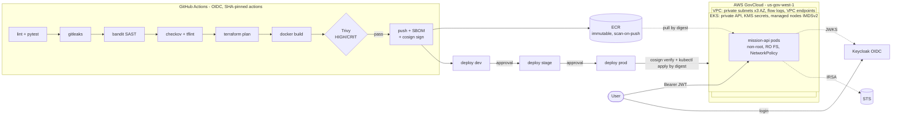

# DevSecOps on EKS: secure delivery for a Keycloak-protected API (GovCloud-ready)

[](https://github.com/OWNER/devsecops-eks-demo/actions/workflows/devsecops-pipeline.yml)
   

An end-to-end reference for **shipping a containerized mission application to Amazon EKS in
AWS GovCloud**, with security built into every stage of the pipeline and the controls mapped
to **NIST 800-53 / RMF** for an ATO.

| Layer | What's here |
|---|---|
| **App** | FastAPI service. `/healthz` is public; `/api/v1/mission` requires a **Keycloak OIDC** JWT with the `mission-reader` realm role. |
| **Container** | Multi-stage build → **distroless**, non-root (uid 65532), healthcheck, no shell. |
| **Local dev** | `docker compose up`: API + Keycloak with an auto-imported realm, client, and test users. |
| **IaC** | Modular **Terraform**: VPC (private subnets, NAT, flow logs, VPC endpoints), **EKS** (managed nodes, IRSA, KMS secrets encryption, private endpoint), **ECR** (immutable, scan-on-push), GitHub OIDC CI role, S3 + DynamoDB remote state. Partition-aware (`aws-us-gov`). |
| **Kubernetes** | Kustomize base + dev/stage/prod overlays: PSA `restricted`, read-only root FS, drop ALL caps, probes, limits, default-deny **NetworkPolicy**, IRSA ServiceAccount, PDB, HPA. |
| **Pipeline** | GitHub Actions: lint/tests → **gitleaks** → **bandit** → **checkov + tflint** → terraform fmt/validate/**plan via OIDC** → build → **Trivy gate** → **syft SBOM** → **cosign keyless sign/attest** → **gated deploys** dev → stage → prod. |
| **Compliance** | [800-53 control mapping](docs/controls-mapping.md), [IL5 / air-gap adaptation](docs/il5-airgap.md), [AppStream 2.0 + SAML extension](docs/appstream.md). |

---

## Architecture



More diagrams: [docs/architecture.md](docs/architecture.md).

---

## Quickstart

### 1. Run locally (Docker + Keycloak)

```bash
docker compose up --build -d          # Keycloak on :8080 (admin/admin), API on :8000
make token                            # access token for analyst1 (has mission-reader)
make call                             # 200 + welcome payload
make call-guest                       # 403: guest1 lacks the role
curl -i localhost:8000/api/v1/mission # 401: no token
```

Test users (local only): `analyst1 / Analyst#Demo2026` (role `mission-reader`) and `guest1 / Guest#Demo2026` (no role).
Swagger UI: http://localhost:8000/docs

### 2. Tests and scans (no Docker needed)

```bash
make install        # venv + pinned dev deps
make lint test      # ruff + pytest (coverage gate 85%)
make sast           # bandit
make tf-fmt tf-validate tflint checkov   # IaC checks (needs terraform, tflint, checkov)
```

### 3. Deploy the infrastructure (GovCloud or commercial)

```bash
# one-time: remote state
terraform -chdir=terraform/bootstrap init
terraform -chdir=terraform/bootstrap apply -var state_bucket_name=<unique-bucket>

# environment
cd terraform/environments/dev
cp backend.hcl.example backend.hcl            # set bucket / table / region
cp terraform.tfvars.example terraform.tfvars  # set account id, repo, region/partition
terraform init -backend-config=backend.hcl
terraform plan -out tfplan && terraform apply tfplan
$(terraform output -raw kubeconfig_command)
```

Then in GitHub: set the repository variables `AWS_CI_ROLE_ARN` (from `terraform output github_actions_role_arn`),
`TF_STATE_BUCKET`, `TF_LOCK_TABLE`, and `AWS_REGION`, and create the **Environments** `dev`, `stage`, and `prod`
(add required reviewers to stage and prod). Until those variables exist, the plan, ECR, and deploy steps
**skip cleanly**, and all scanning still runs.

---

## Pipeline stages

| # | Stage | Tool | Gate / behavior | 800-53 |
|---|---|---|---|---|
| 1 | Lint + unit tests | ruff, pytest | Fails on lint errors, test failures, or coverage < 85% | SA-11 |
| 2 | Secret scanning | gitleaks (full history) | Fails on any detected secret | IA-5 |
| 3 | SAST | bandit → SARIF | Fails on medium+ severity/confidence | SA-11 |
| 4 | IaC scanning | checkov (TF, K8s, Dockerfile, Actions), tflint + AWS ruleset | Fails on any unskipped finding; skips need an inline justification | CM-6, RA-5 |
| 5 | Terraform | fmt, validate, **plan** | Plan runs only when the OIDC role is configured; plan uploaded as an artifact | CM-2, CM-3 |
| 6 | Build + image scan | Buildx, **Trivy** | Fails on fixable HIGH/CRITICAL; full SARIF goes to the Security tab | RA-5 |
| 7 | Publish (main) | GHCR + ECR, **syft**, **cosign keyless** | Same digest to both registries; SPDX SBOM attested; SLSA provenance | CM-8, SI-7, SR-4 |
| 8 | Deploy | kubectl + Kustomize, GitHub **Environments** | dev → stage → prod; approvals; `cosign verify` before apply; deploys by digest; waits for rollout | CM-3, SI-7 |

---

## Security decisions

- **No static cloud credentials.** CI federates to AWS through GitHub OIDC; the trust policy pins `repo:<owner>/<repo>` plus branch or environment. Pods use IRSA, scoped per ServiceAccount.
- **JWT validation done right.** The API checks signature (JWKS, cached), `iss`, `aud`, `exp`/`iat`, and a role, and pins RS256 to block `alg=none` and HS256 key-confusion attacks (both covered by tests).
- **Immutable, verifiable artifacts.** Immutable ECR tags, deploys by `@sha256` digest, and cosign signatures verified against this repo's `main` workflow identity before every deploy.
- **Minimal attack surface.** Distroless image with no shell or package manager, non-root, read-only root FS, all Linux capabilities dropped, seccomp `RuntimeDefault`, and Pod Security Admission `restricted`.
- **Private by default.** Nodes in private subnets, private EKS API endpoint, default-deny NetworkPolicy, a locked-down default SG, and VPC endpoints for ECR, STS, S3, logs, and KMS.
- **Encryption everywhere.** Customer-managed KMS keys (with rotation) for etcd secrets, EBS, ECR, CloudWatch logs, and Terraform state; TLS-only state bucket.
- **Hardened nodes.** IMDSv2 required with hop limit 1 (pods can't reach node credentials), encrypted gp3 volumes, and SSM instead of SSH.
- **Supply chain.** Every third-party action is pinned to a commit SHA; Dependabot updates actions, pip, Docker, and Terraform.
- **Guardrails.** A Terraform `check` fails if credentials resolve to the wrong partition; `allowed_account_ids` blocks the wrong account; validation rejects `0.0.0.0/0` on a public API endpoint.

---

## A real catch from the Trivy gate

The first build of this repo **failed the Trivy gate**, which is the gate doing its job. The initial
dependency pins had fixable HIGH/CRITICAL CVEs, including PyJWT authentication-bypass advisories, a
Starlette DoS, and a Debian 12 `libexpat` issue in the base image. The fix bumped FastAPI, Uvicorn,
and PyJWT and moved the runtime to `distroless/python3-debian13`. The gate now reports
**0 fixable HIGH/CRITICAL**, and the remaining unfixed upstream findings go to the Security tab via
SARIF for tracking (POA&M-style through `.trivyignore` with expiry dates).

---

## Repository layout

```
app/                      FastAPI service + pytest suite
keycloak/                 Realm import (realm, clients, roles, test users) for local dev
Dockerfile                Multi-stage → distroless, non-root
docker-compose.yml        API + Keycloak for local development
terraform/
  bootstrap/              S3 + DynamoDB remote-state backend
  modules/vpc|eks|ecr|github-oidc
  environments/dev/       Root module wiring the modules together
k8s/base, k8s/overlays/   Kustomize manifests (dev/stage/prod)
.github/workflows/        devsecops-pipeline.yml + reusable deploy-eks.yml
docs/                     Architecture, 800-53 mapping, IL5/air-gap, AppStream 2.0
```

---

## Interview talking points

1. **"Security is a pipeline stage, not a review at the end."** Walk the eight stages left to right. Every gate fails the build: secrets, SAST, IaC misconfigurations, fixable HIGH/CRITICAL CVEs. Every stage emits evidence (SARIF, SBOM, plan, signatures) that drops straight into an RMF package. Point to `docs/controls-mapping.md` (SA-11, RA-5, CM-2, CM-3, SI-7, IA-2, AC-2).
2. **"Zero long-lived credentials."** GitHub to AWS uses OIDC with a trust policy pinned to repo and branch or environment. Pods use IRSA, one role per ServiceAccount. Nodes enforce IMDSv2 with hop limit 1 so a pod can't borrow the node role. People authenticate through Keycloak, and the API enforces audience and role.
3. **"What gets deployed is exactly what got scanned."** Immutable ECR tags, deploys by digest, keyless cosign signatures, and a `cosign verify` pinned to the main-branch workflow identity right before `kubectl apply`. The in-cluster next step would be Kyverno or Sigstore policy-controller admission.
4. **"Built for GovCloud, ready for IL5."** The Terraform is partition-aware (`aws-us-gov`) with a partition guardrail. Nodes stay private behind VPC endpoints, so dropping the NAT for a no-egress enclave is a config change. For IL5 or air-gap: Iron Bank base images mirrored to ECR, KMS-backed cosign instead of public Sigstore, FIPS endpoints, and low-to-high artifact promotion with hash and signature re-verification (`docs/il5-airgap.md`).
5. **"Keycloak and AppStream fit the same identity story."** Keycloak acts as an OIDC provider for apps and a SAML IdP for AWS. The same realm can front AppStream 2.0 through SAML role mapping, with fleets spread across AZs for HA, no default internet access, and restricted clipboard and file transfer (`docs/appstream.md`). On the pipeline side, it maps onto GitLab CI or Jenkins in an enclave one-to-one.

---

## License

[MIT](LICENSE) © 2026 George Kamta
