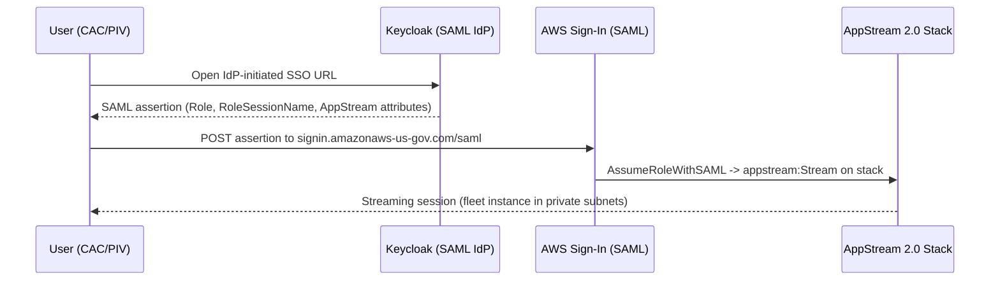

# Optional extension: Amazon AppStream 2.0 with Keycloak SAML

The role lists AppStream 2.0 (image builder, fleets, stacks, scaling, IdP
integration, HA). Here is how it would plug into this repo.

## Flow

## Pieces to add
1. **Keycloak SAML client** for `urn:amazon:webservices:govcloud`, with mappers for
   - `https://aws.amazon.com/SAML/Attributes/Role` → `arn:aws-us-gov:iam::<acct>:role/appstream-users,arn:aws-us-gov:iam::<acct>:saml-provider/keycloak`
   - `https://aws.amazon.com/SAML/Attributes/RoleSessionName` → username
   - `https://aws.amazon.com/SAML/Attributes/PrincipalTag:*` for attribute-based access
   - Relay state: `https://appstream2.us-gov-west-1.aws.amazon.com/saml?stack=<stack>&accountId=<acct>`
2. **Terraform** (`modules/appstream`, not included here):
   - `aws_iam_saml_provider` from Keycloak's IdP metadata.
   - IAM role trusted by the SAML provider and allowed `appstream:Stream` on the stack ARN only.
   - `aws_appstream_image_builder` (in private subnets) to build the golden image, STIG'd with the AppStream Windows/Linux hardening scripts.
   - `aws_appstream_fleet`: on-demand or elastic, `vpc_config` across 2-3 private subnets in different AZs for **HA**, `enable_default_internet_access = false`, and `max_user_duration_in_seconds` / `idle_disconnect_timeout_in_seconds` set for AC-12 session termination.
   - `aws_appstream_stack`: clipboard, file transfer, and printing disabled or restricted (AC-4 data exfil controls), with `user_settings` and an `access_endpoints` interface VPC endpoint so streaming stays private.
   - `aws_appstream_fleet_stack_association`.
   - Application Auto Scaling target and policies on `appstream:fleet:DesiredCapacity` (scale on `CapacityUtilization`, plus scheduled scaling for duty hours).
3. **Pipeline**: an image-build stage that runs the image builder automation (`CreateImageBuilder` → install apps → `CreateImage`), scans it, then updates the fleet image in dev → stage → prod through the same Environment gates.
