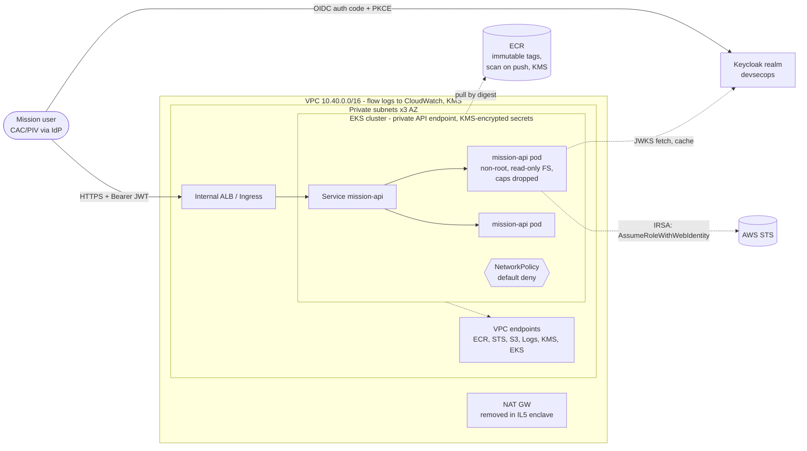
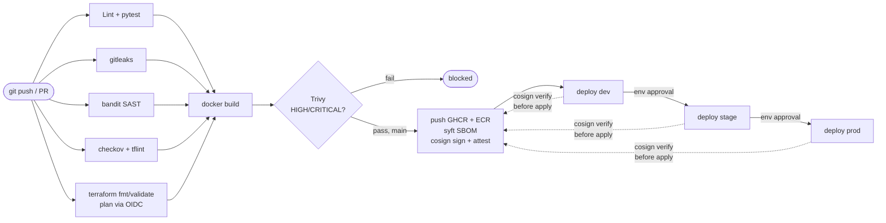

# Architecture

## Runtime (AWS GovCloud, us-gov-west-1)

## Delivery pipeline

## Key design points

| Concern | Decision |
|---|---|
| Identity for users | Keycloak OIDC; API validates RS256 JWT signature, `iss`, `aud`, `exp`, and realm role. |
| Identity for workloads | IRSA: one IAM role per ServiceAccount, scoped by `sub` + `aud` conditions. |
| Identity for CI | GitHub OIDC to AWS STS. No long-lived access keys anywhere. |
| Network | Private subnets only for nodes; private EKS API; default-deny NetworkPolicy; VPC endpoints. |
| Data at rest | Customer-managed KMS keys (rotation on) for EKS secrets, EBS, ECR, logs, TF state. |
| Supply chain | SHA-pinned actions, immutable ECR tags, deploy by digest, cosign keyless signatures, SPDX SBOM. |
| Auditability | EKS control-plane logs (api, audit, authenticator, ...), VPC flow logs, 365-day retention. |
